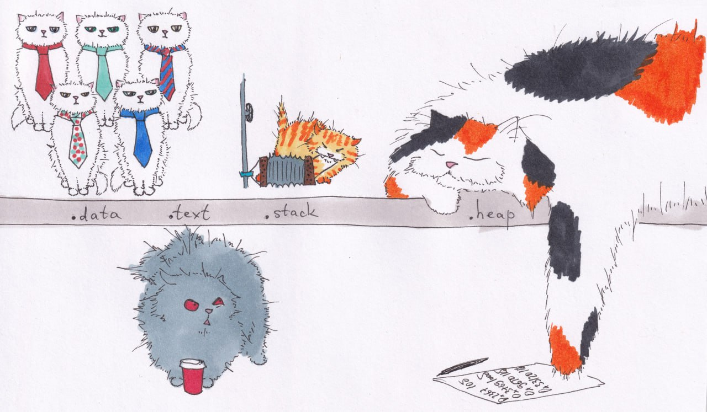

<!-- vscode-markdown-toc -->
* 1. [Структуры](#1)
* 2. [Инициализация структуры](#2)
* 3. [Массив структур](#3)
* 4. [Указатель на структуру](#4)
* 5. [Набивка/Дополнение структуры](#5)
* 6. [Выравнивание](#6)
* 7. [Как вычисляется sizeof структуры](#7)
* 8. [Битовые поля структуры](#8)
* 9. [union (Объединение)](#9)
* 10. [Enum (Перечисление)](#10)
* 11. [typedef](#11)
* 12. [Структуры на практике: IP-пакет и игрок](#12)

<!-- vscode-markdown-toc-config
	numbering=true
	autoSave=true
	/vscode-markdown-toc-config -->
<!-- /vscode-markdown-toc -->

# Структуры. Объединения. Перечисления.          

##  1. <a name='1'></a>Структуры
Структура — это объединение нескольких объектов, возможно, различного типа под одним именем, которое является типом структуры. В качестве объектов могут выступать переменные, массивы, указатели и другие структуры.  
  
Получается, что структура - это новый тип данных, создаваемый нами, позволяющий сгруппировать элементы разных типов.  
Для объявления структуры используется слово "struct", например:  
```c
struct Cat; // Объявили структуру кота, но из чего состоит этот кот?   
```  
Компилятор не знает про понятие кота, т.к. мы еще не определили структуру кота. Давайте определим кота: т.е. опишем из каких полей будет состоять наш кот.  
Например, пусть у кота будет кличка (строковое значение), возраст (целое число), цвет (строка). Тогда определение структуры Cat будет выглядеть примерно так:  
```c  
struct Cat { // определение структуры  
  char *name; // имя кошака  
  unsigned int age; // возраст кота  
  char *color; // цвет  
}; // конец определения  
```  
Определение структуры - это все то, что внутри фигурных скобок. Важно: в конце определения фигурные скобки закрываются ';', также важно понимать, что мы лишь описали структуру (новый тип данных), мы еще не создавали никаких переменных.  
  
Теперь создадим переменную с типом структура кота:  
```c  
struct Cat felix; // Felix - имя переменной с типом данных struct Cat.  
```  
Для того, чтобы обратиться к любому полю нашей структуры необходимо после вызова переменной поставить точку, пример обращения к полям переменной felix:  
```c
felix.name = "Felix";  
felix.age = 5;  
felix.color = "Grey";  
printf("Cat name: %s, age: %d, color: %s", felix.name, felix.age, felix.color);  
```  
На экране мы увидим: "Cat name: Felix, age: 5, color: Grey"  
<br>
<details><summary>Полный код программы с примером. (Нажми, чтоб раскрыть)</summary>
  
```c
#include <stdio.h>  
  
struct Cat { // определение структуры  
  char *name; // имя кошака  
  unsigned int age; // возраст кота  
  char *color; // цвет  
}; // конец определения  
  
int main() {  
  struct Cat felix; // struct Cat - новый тип данных, который мы сами выше определили, Felix - имя переменной с таким типом данных.  
  felix.name = "Felix";  
  felix.age = 5;  
  felix.color = "Grey";  
  printf("Cat name: %s, age: %d, color: %s", felix.name, felix.age, felix.color);  
}  
```

</details>
<br>
  
Итак, в общем виде синтаксис структуры следующий:  
```c
struct ИмяСтруктуры  
{  
  тип ИмяЭлемента1;  
  тип ИмяЭлемента2;  
  ...  
  тип ИмяЭлементаn;  
};  
```
Объявление переменной и обращение к элементам переменной:  
```c
struct ИмяСтруктуры имяПеременной;  
  
имяПеременной.ИмяЭлемента1 = Значение1;  
имяПеременной.ИмяЭлемента2 = Значение2;  
```
    
Рассмотрим еще пару примеров структур. Например стоит задача создать структуру прямой. Прямую можно попробовать описать двумя точками, которые в свою очередь состоят из координат.  
Итак создадим прямую:  
```c
struct Point { // Структура точка(x, y)
  int x;
  int y;
};

struct Line { // Структура прямая
  struct Point p1; // точка 1
  struct Point p2; // точка 2
};

// Создадим переменную my_line и как-нибудь ее заполним
struct Line my_line;
my_line.p1.x = -5;
my_line.p1.y = 4;
my_line.p2.x = 3;
my_line.p2.y = -7;
```
В итоге получится прямая, состоящая из двух точек (-5, 4) и (3, -7), а дальше чего-нибудь с ней делаем по задачам.  
Полезем еще в математику создавать новые типы данных, создадим тип данных комплексное число. Комплексное число по сути есть число, состоящее из двух чисел - реальной и мнимой части.  
Тогда структура комплексного числа будет выглядеть следующем образом:
```c
struct complex {
	int re; // реальная часть
	int im; // мнимая часть
};
```
В памяти структуры располагаются просто: последовательно элемент за элементом, т.е. создав переменную с типом комплексного числа и бродя по памяти мы увидим, что первые sizeof(int) байт будет занимать реальная часть, а вторые sizeof(int) байт мнимая часть.  
Таким образом, структура чем-то похожа на массив элементов (в массивах элементы тоже последовательно располагаются в памяти), но главное отличие в том, что в структуре элементы могут быть разных типов. В качестве типа данных мы можем использовать все что угодно:  
стандартные простые типы (int, float, double, char и тд), массивы, указатели и даже другие структуры данных. Но нельзя создать структуру поле которой будет эта же структура, например:  
```c
struct test {
  // ...
  struct test t;
}

```
Размер такой структуры невозможно посчитать, поэтому за такое компилятор будет бить по рукам.  

Но указатель на свою же структуру - можно, и это очень полезная штука. Так строятся связные списки (до них в курсе ещё дойдём):

```c
struct Node {
  int value;
  struct Node *next; // указатель на следующий узел - ок
};
```

Ещё момент: `char *name` и `char name[128]` - это разные вещи. `char *name` - просто указатель на строку, которая лежит где-то ещё и весит 8 байт (указатель). А `char name[128]` - массив, который лежит прямо внутри структуры, все 128 байт. Поэтому в первом случае строку через `name` менять нельзя (она может быть в read-only памяти), а во втором - можно.


##  2. <a name='2'></a>Инициализация структуры

Вернемся к структурам и котикам. Заполнить переменную типа структуры можно несколькими способами:

```c
// Определяем структуру Cat
struct cat {
	char *name;
	int age;
};

// Варианты инициализации структуры
struct cat tom = { "Tom", 5 }; // Первый способ
struct cat felix = { .name = "Felix", .age = 4 }; // Второй
struct cat mango; // Третий
mango.name = "Mango";
mango.age = 3;

print_cat(tom);
print_cat(felix);
print_cat(mango);
```
В 1 варианте мы в фигурных скобках прописываем подряд константы или переменные, значения которых хотим записать последовательно в структуру. Получится переменная tom, у которой name будет "Tom", а age = 5.  
Во 2 варианте мы явно указываем имя элемента (поля) структуры.  
И еще один вариант отдельно объявили переменную и отдельно ее заполнили.  

Также важно отметить, что структуры как и простые типы данных типа int, float и пр. можно передавать и возвращать из функций.   
[Полный пример c print_cat() тут](src/cats.c) 

##  3. <a name='3'></a>Массив структур

Иногда нам бывает мало одной структуры и хочется их много и чтобы в одной переменной. Для этого можно создать массив структур.
```c
struct funny {
  char name[128];
  char *fate;
};

struct funny cats[] = {{"Yaqub Qomarudin Dibizah", "👑"},
                        {"Khalid Kashmiri", "🗡️"},
                        {"Khidir Karawitah", "⚔️"},
                        {"Ismail Ahmad Khan Nabawi", "🐎"},
                        {"Utsman Abdul Jalil Shisha", "📚"},
                        {"Muhammad Sumbul", "♐"}};
```
Для получения конкретного кота из массива котов, обратимся по индексу к массиву cats:  
```c
printf("Cat name: %s", cats[1].name); // => "Khalid Kashmiri"
```
Таким образом при работе с массивом структур сначала используется индексация для получения конкретной структуры из массива, а затем уже выбирается сам элемент структуры.  
[Пример массива кошаков](src/cats_array.c)                 

             

##  4. <a name='4'></a>Указатель на структуру

Указатели бывают на все типы данных и даже на функции, структуры не исключения, они как и все что трогает процессор лежит в оперативной памяти и содержит свой адрес.  

         

В следующем примере рассмотрим указатель на структуру.  
```c
struct test {
	char a;
	int b;	
};

struct test a; // переменная со структурой test
struct test *ptr; // переменная-указатель на структуру test

ptr = &a; // берем адрес a и записываем его в ptr
ptr->a = 'A'; // работаем с переменной a косвенно
ptr->b = 555;
```

`ptr->a` - то же самое, что `(*ptr).a`: сначала разыменовать указатель, потом обратиться через точку. Стрелка просто короче.

Указатели на структуры нужны в основном для динамической памяти - из них потом вырастают связные списки (курс САОД).

На практике это выглядит так. Создаём структуру в куче и работаем через указатель:                

```c
struct Cat *p = malloc(sizeof(*p)); // размер структуры, на которую указывает p
p->name = "Felix";
p->age = 5;
free(p); // не забываем вернуть память
```

`sizeof(*p)` удобнее, чем `sizeof(struct Cat)`: не повторяем имя типа и если тип поменяется, ничего не сломается.            

А в функцию большую структуру передаём по указателю, чтобы не копировать её целиком:        

```c
void print_cat(const struct Cat *c) {
  printf("Cat: %s, %u\n", c->name, c->age);
}
// вызов: print_cat(&felix);
```

`const` здесь говорит: функция структуру только читает, менять не будет.             

Чтобы было наглядно, где что лежит: `.text` - код, `.data` - глобальные переменные, `.stack` - локальные, а `.heap` - то, что выделил `malloc`:           

          

**Важно:** при обращении к элементу указателя на структуру используется '->', а при работе с обычной структурой '.'

##  5. <a name='5'></a>Набивка/Дополнение структуры

Не во всех книжках об этом говорится, но есть такое понятие как выравнивание структур. Допустим у нас есть структура test, состоящая из двух полей:
```c
struct test {
	char a;
	int b;
};
```
Если попробовать посчитать ее размер, то может показаться что он будет равен 5, т.к. sizeof(char) у нас всегда 1 байт, а sizeof(int) допустим 4 байта. 4 + 1 = 5, простая математика, но все не так просто.  
Если написать sizeof(struct test), то мы приятно удивимся размером 8 байт. Но откуда еще 3 байта? Хорошо, мы с вами уже немного понимаем указатели и знаем как пройтись по памяти по 1 байту.  
```c
struct test t = { 'A', 49407 }; // переменная t типа struct test
char *a = (char *)&t; // возьмем адрес t и запишем его в наш указатель на char
for (int b = 0; b < sizeof(struct test); b++) { // цикл на 8 повторений
  printf("%hhu ", *a); // выводим один байт в безнаковом формате
  a++; // прибавляем 1 к текущему адресу a
}
printf("\n");
```
И мы увидим примерно следующую картину:

Первый байт у нас будет равен 65, что по таблице ASCII есть символ 'A', тут все ок. Идем дальше и видим нули либо мусор целых 3 байта. А затем уже наше число 49407, разделенное на 4 байта.  
Тоесть у нас после char a вылезло лишних 3 байта никак неиспользуемой нами памяти. Откуда это и зачем, допустим я такого не хочу и не хочу, чтобы моя програма много памяти неиспользуемой выделяла. Пойду загуглю как убрать такое и сделать мою структуру из 5 байт.  
И там я найду примерно следующее:
```c
struct test {
	char a;
	int b;
} __attribute__((packed));

struct test my_test; // sizeof(my_test) = 5
```
Какой-то атрибут пакет можно использовать и вроде размер структуры стал равен 5. Все четко, можно радоваться что победили непонятные потерянные байты. Но есть нюанс)  
Нюанс заключается в том, что этот самый padding (набивка на русском) включает компилятор не просто так, а для более быстрого выполнения вашей программы на процессоре. Мы хоть и будем занимать меньше места в памяти, но это будет работать медленнее..  
Правило примерно следующее: Компилятор возьмет в структуре самый большой размер переменной и положит всю структуру начиная с адреса кратного этому размеру. Дальше на картинках будет понятнее.  
Чуть подробнее про это на следующих слайдах.

[Пример с sizeof и padding](src/padding.c)


##  6. <a name='6'></a>Alignment (Выравнивание)

Современные процессоры работают с числами, у которых размер кратен степени 2, т.к. у нас везде двоичная система исчисления. Процессор отлично работает с числами в 1 байт, 2, 4, 8, 16.. байт.  
Процессор будет быстро работать с числами расположенными по адресу, который кратен их размеру. Если для 4 байтного числа адрес кратен 4, то процессор считает такое число за 1 такт.  
Такой подход наиболее эффективен при проектировании процессоров и позволяет делать процессоры более компактными.  
Выравнивает данные по адресам компилятор  
Вся эта штука с выравниваем переменных по адресам наиболее заметна на структурах, однако если повыводить адреса обычных переменных, то мы увидим, что их адреса кратны их размеру.

Рассмотрим небольшой пример как это устроено со структурой из предыдущего слайда test.

Если у нас переменная b типа int лежит по адресу кратному ее размеру (адрес 104, размер 4 байта, 104 % 4 == 0), то такую переменную процессор очень быстро заберет и обработает


Однако если переменная b по какой-то причине будет располагаться на 2 байта раньше, то произойдет такая ситуация:


Процессору понадобится целых 4 такта для чтения этой переменной, что как бы в 4 раза медленнее если бы переменная лежала просто на более удобном адресе.  
Почему в 4 раза дольше: Процессор не сможет начать читать 4 байта, начиная с адреса 102. Он прочитает два слова по 4 байта, с адреса 100 (кратен 4) и адреса 104 (тоже кратно 4).  
Получит два целых числа из 8 байт между которых находится искомое число из 4 байт. Далее он их начнет обрезать и склеивать, чтобы получить нашу переменную b лежащую по не наилучшему адресу.  
  
В итоге получается, что компилятор добавляя набивку из нулей или мусора дает возможность процессору считать данные из памяти быстрее. Из-за чего наша программа будет работать чуточку быстрее.  

##  7. <a name='7'></a>Как вычисляется sizeof структуры

Возьмем две структуры и посчитаем размер.

```c
struct test1 {
	char a;
	int b;
	char c;
	int d;	
};

struct test2 {
	int b;
	int d;
	char a;
	char c;
};

```

В первом случае получится размер 16 байт.  
Во втором случае размер 12 байт. Как это так получилось? Одинаковые поля вроде, но размер отличается из-за их местоположения.  
Все просто, вспоминаем, что компилятор пытается расположить переменные по адресам кратным их размеру, т.е. char можно по любому адресу расположить (размер char = 1 байт), а int только по адресам кратным sizeof(int).  
Получается в первой структуре будет после каждого char набивка из 3 байт для того, чтобы int встал по адресу кратному 4 (sizeof(int)). И такая история повторяется дважды. Итого получается:  
1 + 3 + 4 + 1 + 3 + 4 = 16 байт (где 3 это набивка перед int, 1 это размер одного char и 4 размер int)  
Во втором случае есть два int, адреса у int не нужно набивать, 4 + 4 + 1 + 1 = 10 байт, откуда еще 2 байта? Еще 2 байта будет из-за набивки после двух char. Компилятор будет стараться выровнять структуру по наибольшему элементу в структуре, т.е. int, и даже если у нас осталось 2 байта, то компилятор их заполнит так, чтобы то, что будет находитсья после структуры находилось по адресу кратному sizeof(int).


##  8. <a name='8'></a>Битовые поля структуры

В языке Си мы можем в структуре данных задавать конкретным полям сколько БИТ они будут занимать. Т.е. помимо битовых операций для работы с битами можно использовать структуры.  

Создадим структуру байта, состоящую из 8 полей ознащающих каждый бит байта. Для того чтобы каждое поле занимало 1 бит, после имени элемента ставится двоеточие и указывается число бит, которое будет занимать данный элемент.  

```c
struct byte {
  unsigned char b0:1;
  unsigned char b1:1;
  unsigned char b2:1;
  unsigned char b3:1; 
  unsigned char b4:1; 
  unsigned char b5:1; 
  unsigned char b6:1; 
  unsigned char b7:1; 	
};

char a = 0b00010001; // 17
struct byte *bits; // указатель на структуру
bits = (struct byte *)&a; // берем адрес а и записываем его в bits

bits->b0 = 0; // 0 бит числа a

```
Создадим переменную a = 17, в двоичном виде это будет 00010001. Также создадим указатель на структуру байт и запишем в него адрес переменой a.   
Теперь при обращении к переменной bits (указатель на структуру) мы будем работать с конкретными битами переменной a.   
Например заменить нулевой бит переменной a это будет bits->b0 = бит.  

Здесь стоит обратить внимание на тип данных в структуре byte, почему он unsigned char, а не просто char? Если заменим на char и попробуем вывести бит = 1, то получим на экран -1.  
т.е. для char состоящего из 1 бит значения будут -1 и 0. Почему так? Вспоминаем знаковые типы данных и отрицательные числа и дополнительный код. Первый бит (он же и единственный) отвечает за знак числа, поэтому получим -1 если bit = 1.  


##  9. <a name='9'></a>union (Объединение)

Есть еще один тип данных, похожий на struct, но отличающийся тем как данные располагаются в памяти.  
Union - на русском объединение. Это структура объединяющая элементы в одной области памяти. Рассмотрим пример:

```c
union my_union {
	char a;
	int b;
};
```
Объявим union с элементами типа char и int, размер union = размеру наибольшего элемента, в данном случае sizeof(union my_union) == sizeof(int).   
Создадим переменную test типа union my_union и запишем туда символ A в элемент а:  
```c
union my_union test;
test.a = 'A';
```
В памяти будет выглядеть данный union следующим образом:  

Возьмем теперь и запишем в поле b число 12345:  
```c
test.b = 12345;
```
Получим следующую картину в памяти:  

Число b перезаписало значение a и теперь если выводить a, то мы увидим там символ '9'.  

Почему именно '9': 12345 в шестнадцатеричном виде - это 0x3039, младший байт 0x39 = 57 = символ '9'. Младший байт идёт первым - это little-endian, так устроен x86. На big-endian платформе (некоторые ARM, старое сетевое железо) вы бы увидели другой символ. Так что union, чтобы "посмотреть байты числа", - приём, зависящий от платформы.          

Когда и зачем использовать такую странную штуку как union?  
Объединения можно использовать в основном для экономии памяти.  
Например у нас есть структура содержащая union и int, содержащий информацию о том, какую из структур использовать в union:
```c  
struct test {
  int type;
  union u {
    struct foo a;
    struct bar b;
  };
};
```
Если type скажем будет равен 1, то используем элемент a структуры struct foo, если type == 2, то структуру b.

[union пример](src/union.c)              

в union можно использовать массивы, например:      
```c
union {
  char a[4];
  int b;
} u;
```
Таким образом мы можем положить в память 4 байтное число (int) и посмотреть любой его байт через массив a               

Тот же приём в реальной жизни - IP-адрес. Его хранят как одно 32-битное число, но иногда удобнее смотреть на него как на 4 байта (октета):

```c
union ipv4 {
    uint32_t as_int;     // весь адрес одним числом
    uint8_t  octets[4];  // или по байтам
};

union ipv4 addr;
addr.octets[0] = 192;
addr.octets[1] = 168;
addr.octets[2] = 0;
addr.octets[3] = 1;

printf("адрес числом: %u\n", addr.as_int);
```

Одна и та же память - два взгляда на неё, вот и весь union. Единственный подвох - снова endianness: порядок байтов в `as_int` зависит от платформы. Именно так IP-адреса и хранятся в сетевом коде, о котором речь в конце лекции.

##  10. <a name='10'></a>Enum (Перечисление)

Перечисления - перечисляет различные возможные варианты целочисленный значений. Понятнее будет на примере.  
Пишем мы какого-то робота, опознающего разные цвета. И в зависимости от цвета этот робот что-то предпринимает.  
Перечислим некоторые цвета и присвоим им некоторые значения, создадим переменную my_color и положим туда цвет зеленый.
```c
enum colors {
  RED, // по умолчанию будет = 0
  GREEN, // = 1
  BLUE = 5,
  ORANGE // будет равно 6
};

enum colors my_color = GREEN;
```
После слова enum идет имя нашего enum - colors. RED, GREEN - значения вместо цифр, которые интуитивно более понятны чем использовать 0 в качестве RED, а 1 == GREEN.  
Если перечислять через запятую наши элементы enum, то им будут присваиваться значение предыдущего + 1. По умолчанию enum начинает перечисление с нуля.

Далее с этой переменной и вообще с enum очень хорошо сочетается switch - case: т.к. switch case шустро работает с case, которые расположены по возврастанию с шагом 1.  
```c
switch (my_color) {
  case RED:
  // выполнить что-то если красный
  case GREEN:
  // выполнить что-то если зеленый
}
```
Все это полезно когда хочется иметь строковый аналог числам, где вместо использования чисел более понятнее будет использовать слова, которые прямым текстом говорят что значит цифра. Не нужно бежать в какой-то файл и искать в комментариях какая цифра за какой цвет отвечает     

[enum пример](src/enum.c)

##  11. <a name='11'></a>typedef

Язык Си позволяет определять имена новых типов данных с помощью ключевого слова typedef. Например все привычные нам int, float и т.д типы данных можно заменить на смайлики и мы как будто создадим свой язык программирования из смайликов.

Делается это через typedef:  
typedef тип имя;

Например:
```c
typedef unsigned int uint; // один раз где-нибудь напишем
uint a; // теперь uint это тоже самое, что и unsigned int
```

typedef позволяет сокращать некоторые имена. Программисты ленивые люди как мы помним и эти сокращения довольно часто используется, однако могут также и вводить в заблуждения если сокращенное имя тяжело расшифровать.

Пример со структурой, где struct test теперь будем называть просто test (вместо двух слов целое одно вау)
```c
typedef struct test test;
test a;
```

Можно такое делать сразу при объявлении структуры:
```c
typedef struct cats {
	int age;
	char name[64];
} cats_t;
cats_t cats = {3, "Mango"};
```

Часто можно встретить сокращенные имена структур, которые будут заканчиваться на "_s", под этим подразумевают некоторую структуру. "_e" - сокращение enum, "_u" - сокращение union или "_t" - некоторый тип данных.  
Например из заголовочного файла <stdint.h>: uint8_t это unsigned char, а int8_t это просто char.

[typedef пример](src/typedef.c)

##  12. <a name='12'></a>Структуры на практике: IP-пакет и игрок

Всё, что мы разобрали - struct, битовые поля, union, порядок байт, - собирается вместе в реальных сетевых структурах. Например, в заголовке IPv4 (RFC 791). Каждый пакет в интернете начинается с него:

```c
#include <stdint.h>

// Заголовок IPv4: 20 байт без опций
struct ip_header {
    uint8_t  version_ihl;   // версия (4 бита) + длина заголовка (4 бита)
    uint8_t  tos;           // тип обслуживания (Quality of Service)
    uint16_t total_length;  // длина всего пакета
    uint16_t id;            // идентификатор для сборки фрагментов
    uint16_t flags_frag;    // флаги + смещение фрагмента
    uint8_t  ttl;           // time to live: сколько ещё маршрутизаторов переживёт
    uint8_t  protocol;      // 6 = TCP, 17 = UDP, 1 = ICMP
    uint16_t checksum;      // контрольная сумма заголовка
    uint32_t src_addr;      // IP отправителя
    uint32_t dst_addr;      // IP получателя
};
```

Тот же заголовок можно описать и через битовые поля:

```c
struct ip_header_bits {
    unsigned int ihl:4;     // длина заголовка
    unsigned int version:4; // версия (порядок зависит от платформы!)
    uint8_t tos;
    uint16_t total_length;
    // ...
};
```

А применяется это так: пришёл буфер с байтами, и мы смотрим на него как на заголовок:

```c
void handle_packet(const unsigned char *buf) {
    struct ip_header *ip = (struct ip_header *)buf;

    printf("protocol = %u\n", ip->protocol);
    printf("ttl = %u\n", ip->ttl);
    printf("src = %u.%u.%u.%u\n",
           ip->src_addr & 0xff,
           (ip->src_addr >> 8) & 0xff,
           (ip->src_addr >> 16) & 0xff,
           (ip->src_addr >> 24) & 0xff);
}
```

Два подвоха, о которых надо помнить:

1. **Сетевой порядок байт.** В IP-пакете все числа лежат в big-endian, а твой компьютер, скорее всего, little-endian. Поэтому `total_length`, `src_addr` и остальные поля перед использованием переводят: `ntohs()` (16 бит) и `ntohl()` (32 бита) из `<arpa/inet.h>`.
2. **Выравнивание.** Реальный буфер может прийти по невыровненному адресу, и `(struct ip_header *)buf` с невыровненным `uint32_t` - это технически UB. В боевом коде байты копируют в структуру через `memcpy` или читают поля по одному.

Этот же принцип - "смотрим на массив байтов как на структуру" - используется для разбора любых бинарных форматов: ELF, PNG, MP3, заголовки TCP/UDP и так далее.

А чтобы запомнить, где в этой картине живёт IP: вот семь котов модели OSI, IP сидит на сетевом уровне (3):


####  Ещё пример попроще: игрок

Не обязательно лезть в сетевые протоколы. Вот структура игрока из простенькой игры:

```c
struct Player {
    char  name[16]; // ник
    int   hp;       // здоровье
    float x, y;     // координаты на карте
};
```

В памяти это просто 28 байт подряд: 16 на имя, 4 на здоровье, 4 на x и 4 на y.      


С такой структурой удобно работать: двигать (`p->x += dx`), наносить урон (`p->hp -= damage`), менять ник. Одна структура собирает всё, что относится к игроку, в один объект.

А если у игрока бывает разное оружие, сюда же ложится union. Меч, лук и посох занимают одну и ту же память, потому что одновременно в руках только что-то одно:

```c
struct Player {
    char  name[16];
    int   hp;
    float x, y;

    enum WeaponType { SWORD, BOW, WAND } weapon_type; // что сейчас в руках
    union {
        struct { int damage; } sword;          // меч: только урон
        struct { int damage; int range; } bow; // лук: урон и дальность
        struct { int damage; int mana; } wand; // посох: урон и мана
    } weapon;
};
```
Пользуемся так:

```c
struct Player p = { .name = "Hero", .hp = 100, .x = 0, .y = 0 };
p.weapon_type = BOW;
p.weapon.bow.damage = 15;
p.weapon.bow.range = 30;
```

`weapon_type` подсказывает, какое поле в union сейчас актуально


