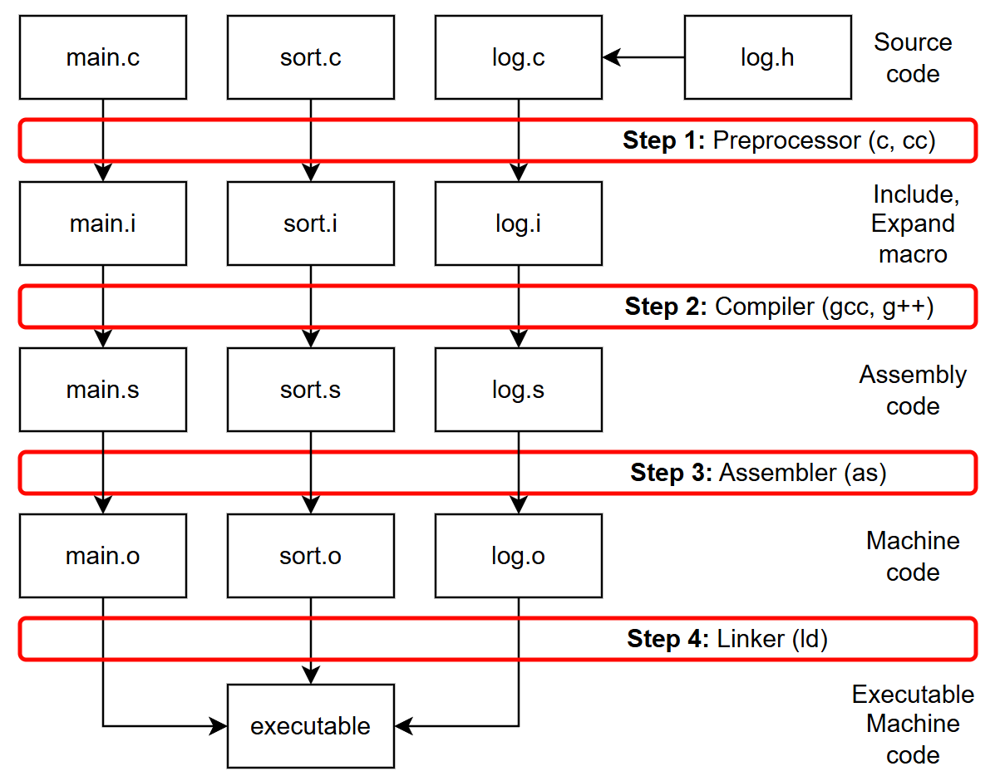
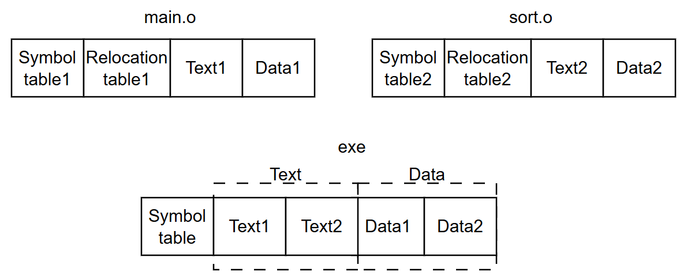

<!-- vscode-markdown-toc -->
* 1. [Зачем делить на файлы](#1)
* 2. [.h и .c: интерфейс и реализация](#2)
* 3. [Как собрать несколько файлов](#3)
* 4. [Этапы компиляции и линковка](#4)
* 5. [Системы сборки (пока глазами)](#5)

<!-- vscode-markdown-toc-config
	numbering=true
	autoSave=true
	/vscode-markdown-toc-config -->
<!-- /vscode-markdown-toc -->

# Многофайловый проект

##  1. <a name='1'></a>Зачем делить на файлы

Пока что весь код мы писали в одном файле - и это нормально, пока программа маленькая. Но когда строк становится тысячи, один файл превращается в кашу: трудно читать, трудно искать, а при командной работе над одним файлом вечно возникают конфликты.

Многофайловый проект - это когда программа разбита на несколько `.c`-файлов, и каждый отвечает за свою задачу. Реальные проекты состоят из тысяч файлов: ядро Linux - это около 18 миллионов строк кода.

Что это даёт:
- готовый модуль можно подключать к другим проектам;
- при изменении одного файла пересобирается только он, а не всё подряд;
- проще ориентироваться в проекте и делить работу между людьми.

Главное правило - **один модуль = одна задача**. Файл, который работает с сетью, не должен рисовать графику. Но и делить 200 строк на 100 файлов смысла нет.

##  2. <a name='2'></a>.h и .c: интерфейс и реализация

В Си каждый модуль принято делить на два файла:

- **`.h` - заголовок (интерфейс).** Объявляем, *что* модуль умеет: прототипы функций, структуры, константы, макросы. Это "инструкция, как пользоваться модулем".
- **`.c` - реализация (логика).** Пишем сами функции, то есть *как* это работает.

Пример. Заголовок `utils.h`:

```c
#ifndef UTILS_H
#define UTILS_H

int sum(int a, int b);

#endif
```

Реализация `utils.c`:

```c
#include "utils.h"

int sum(int a, int b) {
    return a + b;
}
```

Точка входа `main.c`:

```c
#include <stdio.h>
#include "utils.h"

int main(void) {
    printf("%d\n", sum(2, 3));
}
```

Что здесь важно:
- `#include "utils.h"` - препроцессор просто вставляет содержимое заголовка в файл. Поэтому в `main.c` компилятор уже знает, что функция `sum` существует, и может проверить, правильно ли мы её вызвали.
- `extern` в заголовках (например `extern int x;`) значит "объект определён в другом файле, найдём его на линковке". У прототипов функций `extern` подразумевается по умолчанию.
- `#ifndef / #define / #endif` - защита от повторного включения (include guard): если заголовок подключается дважды, второй раз он пропускается.

##  3. <a name='3'></a>Как собрать несколько файлов

Достаточно перечислить все `.c`-файлы через пробел:

```bash
gcc main.c utils.c -o app
./app
```

Если заголовки лежат не рядом, указываем, где их искать, флагом `-I`:

```bash
gcc main.c src/utils.c -Isrc -o app
```

Теперь в коде можно писать просто `#include "utils.h"`, а не `#include "src/utils.h"`.

##  4. <a name='4'></a>Этапы компиляции и линковка

Внутри gcc проходит 4 шага:



1. **Препроцессор** - раскрывает `#include`, `#define` и прочие директивы.
2. **Компиляция** - Си превращается в ассемблер.
3. **Ассемблирование** - ассемблер превращается в машинный код, получается объектный файл `.o`.
4. **Линковка** - объектные файлы склеиваются в один исполняемый файл.

Посмотреть все шаги: `gcc main.c -o main -###`

Можно собирать и по шагам вручную:

```bash
gcc -c main.c -o main.o    # только компиляция, без линковки
gcc -c utils.c -o utils.o
gcc main.o utils.o -o app  # линковка
```

Так и делают в больших проектах: поменялся один файл - пересобрали только его, остальные `.o` остались готовыми.



Линковщик связывает вызовы функций с их кодом. Поэтому две классические ошибки линковки:

- **`undefined reference to 'sum'`** - функцию объявили (прототип есть), но ни в одном `.c` её не реализовали;
- **`multiple definition of 'sum'`** - функцию определили в двух файлах, и линковщик не знает, какую брать.

##  5. <a name='5'></a>Системы сборки (пока глазами)

Когда файлов много, набирать `gcc` с кучей флагов руками неудобно. Для этого есть системы сборки: **Make**, **CMake**, **Meson**, **Ninja**. Подробно разберём их в отдельной лекции, а пока достаточно просто посмотреть на Makefile - что он делает, читается почти как обычный текст:

```makefile
app: main.o utils.o
	gcc -o app main.o utils.o

main.o: main.c utils.h
	gcc -c main.c -o main.o

utils.o: utils.c utils.h
	gcc -c utils.c -o utils.o

clean:
	rm -f *.o app
```

Запуск:

```bash
make        # соберёт app (пересоберёт только то, что изменилось)
make clean  # удалит собранные файлы
```

Строка вида `цель: зависимости` означает: чтобы получить `main.o`, нужны `main.c` и `utils.h`, и пересобирать надо только если что-то из них новее. На этом принципе и работает `make`.
