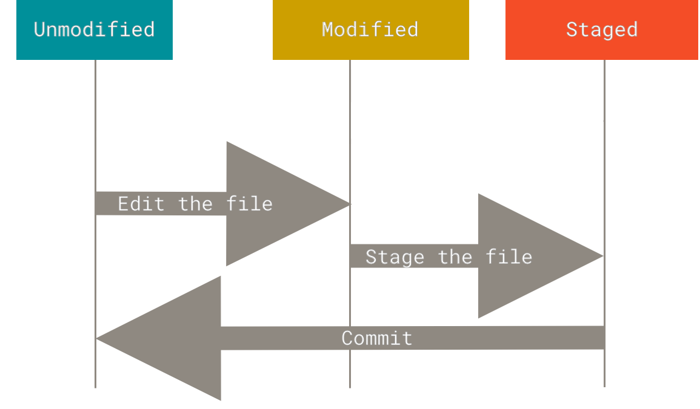
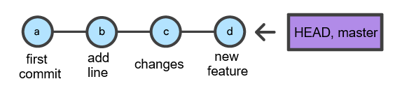
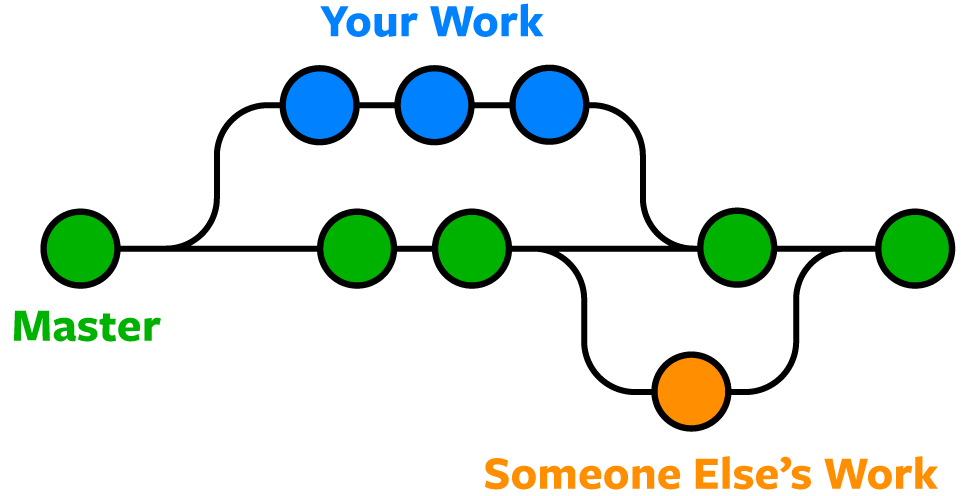
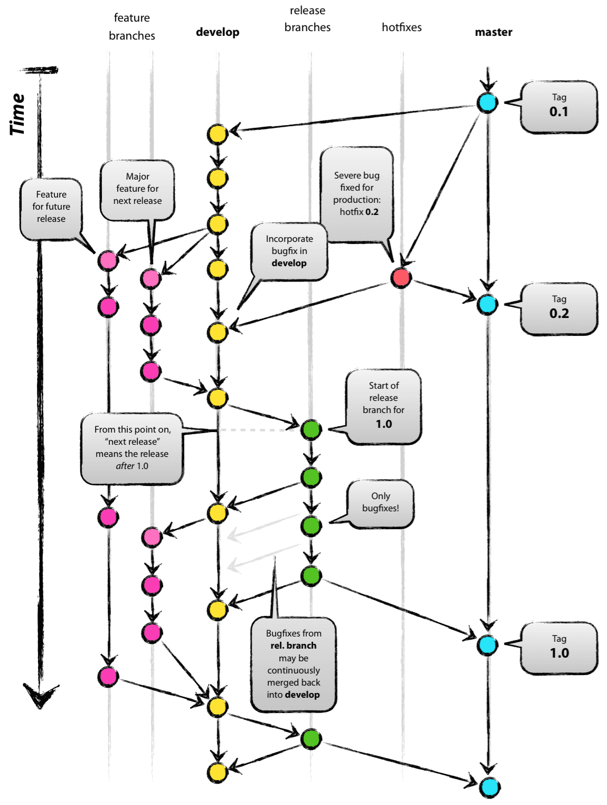

<!-- vscode-markdown-toc -->
* 1. [Кто такой Git](#1)
* 2. [Git и GitHub - не одно и то же](#2)
* 3. [Практика](#3)
	* 3.1. [Установка и настройка](#3.1)
	* 3.2. [Репозиторий](#3.2)
	* 3.3. [Запись изменений: stage и коммит](#3.3)
	* 3.4. [Удаленный репозиторий: push, pull, fetch, clone](#3.4)
	* 3.5. [Ветки и слияние](#3.5)
	* 3.6. [Отмена изменений](#3.6)
	* 3.7. [Версия проекта в исполняемом файле](#3.7)
	* 3.8. [Дополнительно: stash, submodules, GitLens](#3.8)

<!-- vscode-markdown-toc-config
	numbering=true
	autoSave=true
	/vscode-markdown-toc-config -->
<!-- /vscode-markdown-toc -->

# Система контроля версий Git

Есть ситуация, через которую проходят все. Неделю пишете лабу, все собирается, вы вносите "последнюю маленькую правку" - и оно перестает работать. Откатиться некуда, потому что бэкапы вы делали руками: `lab.c`, `lab_final.c`, `lab_final_2.c`, `lab_final_2_TRUE.c`. Git придуман ровно для того, чтобы этого больше не было.

Ну и практическая причина: лабы в этом курсе сдаются через GitHub, так что дальше без него никуда.

Ссылки, к которым будете возвращаться весь семестр:
- [книга Pro Git](https://git-scm.com/book/ru/v2) - лучший учебник, есть на русском
- [документация Git](https://git-scm.com/doc) и [документация GitHub](https://docs.github.com/ru)
- [Git Katas](https://github.com/eficode-academy/git-katas/tree/master) - короткие упражнения на каждую команду
- [LearnGitBranching](https://learngitbranching.js.org/?locale=ru_RU) - тренажер по веткам, лучший способ понять merge


[github.com/globe](https://github.com/globe)

##  1. <a name='1'></a>Кто такой Git

 

Git (говорят "гит", не "джит") - распределенная система управления версиями. Придумал его Линус Торвальдс для ядра Linux, первая версия вышла 7 апреля 2005 года.

История вышла почти анекдотичная. До этого ядро жило в BitKeeper - чужой программе, которую разработчикам разрешали использовать бесплатно. Потом у владельцев BitKeeper случился конфликт с разработчиками ядра, бесплатный доступ отозвали, и все разом остались без инструмента: история правок закрыта, работать нечем. Линус не стал искать замену, а сел и за пару недель написал свою.

Если убрать определение, то Git - это программа, которая помнит, как выглядели ваши файлы в каждый момент времени. Не "сохраняет", а именно помнит все версии: можно вернуться на неделю назад, можно посмотреть, кто и когда сломал конкретную строку, можно спокойно работать вдвоем над одним файлом.

Популярнее его сегодня ничего нет, аналоги есть, но тратить на них время смысла ноль: в какой бы компании вы ни оказались, там будет Git, и неважно, на чем вы пишете.

**Что это дает руками, а не на словах.**

- Видно всю историю файла: что добавили, что удалили и когда. Удаленная функция никуда не делась, она лежит в старом коммите.


- Можно откатиться (revert) к последней рабочей версии. Спасает в тот самый момент, когда "оно же только что работало".


- Можно экспериментировать, не ломая рабочую версию: делаете копию кода, пробуете там что угодно, и только если получилось - сливаете обратно.
 

- Можно синхронизировать код между людьми и компьютерами: актуальная версия с историей лежит на сервере, а не пересылается архивом в чат.


##  2. <a name='2'></a>Git и GitHub - не одно и то же

На первой лабе это путают все, поэтому сразу разведем.

**Git** - программа на вашем компьютере. Работает без интернета, знает только ваш диск.

**GitHub** - сайт, куда складывают копии репозиториев. Внутри у него тот же Git, а сверху - веб-интерфейс: аватарки, issues, pull requests и зеленая сетка коммитов, которой все хвастаются.

Кроме GitHub есть GitLab и Bitbucket. Разница примерно как между почтами: письма одинаковые, сайты разные. Работать будем с GitHub, он самый доступный.

##  3. <a name='3'></a>Практика

###  3.1. <a name='3.1'></a>Установка и настройка

Ставим Git с [git-scm.com](https://git-scm.com/book/ru/v2/Введение-Установка-Git), заводим аккаунт на [GitHub](https://github.com). Если регистрация капризничает - попробуйте почту gmail, обычно помогает.

Дальше один раз представляемся, иначе Git не знает, кто автор коммитов. Делается это двумя командами:
```bash
git config --global user.name "User Name"
git config --global user.email username@example.com
```
Проверить, что записалось:
```bash
git config --global user.name
git config --global user.email
```

Git - консольная утилита с сотней флагов, но справочник всегда под рукой:
```bash
git --help
git config --help
```

В VSCode вкладка для Git уже есть - Source Control, иконка с веткой слева. Мышкой там можно все. Но команды в консоли знать все равно придется: они одинаковые в любом редакторе, в терминале на сервере и в чужом видео на ютубе.

###  3.2. <a name='3.2'></a>Репозиторий

Репозиторий - это папка с проектом, которая помнит все свои прошлые состояния. Сокращают "repo" или "гитрепо".

Два сценария, и они разные:
- проект уже есть на GitHub - его скачивают через `git clone` (раздел 3.4)
- проект начинается с нуля - папку превращают в репозиторий командой `git init`
```bash
git init
```
Внутри появится скрытая папка `.git` - вот в ней и лежит вся история. Удалите ее - останется обычная папка с файлами, и никакой истории в ней уже не будет. Иногда этим пользуются, когда хотят "начать заново", но лучше так не делать.

Если создаете пустой репозиторий на GitHub, он сам покажет команды, которые надо выполнить. Можно просто скопировать их оттуда.

###  3.3. <a name='3.3'></a>Запись изменений: stage и коммит

Дальше самое рабочее: как сохранить сделанное. И здесь половина проблем новичков из-за того, что состояние файла не одно, а целых четыре.

- неизмененный (unmodified) - с прошлого коммита ничего не трогали
- измененный (modified) - код поменяли, но Git об этом еще не знает
- подготовленный (staged) - изменения лежат в индексе, то есть в следующем коммите
- неотслеживаемый (untracked) - файл новый, Git его вообще не видел

Областей, между которыми файл бегает, три:

```
  рабочий каталог              индекс (stage)             репозиторий
   hello.c  --- git add --->  hello.c  --- git commit --->  коммит a1b2c3d
            <-- restore --staged --      <-- reset --soft --
```

Та же схема картинкой, если глазами проще:



`git status` - команда, которую вы будете набирать чаще всех остальных, потому что она же и подсказывает, что делать дальше:
```bash
git status
```
Вот так выглядит счастье:
```bash
On branch master
Your branch is up-to-date with 'origin/master'.
nothing to commit, working tree clean
```
Если появились файлы, напротив каждого будет буква: `M` - modified, `U` - untracked. В VSCode то же самое в Source Control, только цветами.

Что именно поменяли в файле:
```bash
git diff
```
Плюсы и зеленый - добавили, минусы и красный - удалили. В VSCode это просто открыть файл из списка Changes.

Понравившиеся изменения складываем в индекс:
```bash
git add <файлы>
```
Вместо файлов можно указать папку, тогда она добавится целиком, со всем содержимым. Из корня проекта обычно так:
```bash
git add .
```
В VSCode - ПКМ по файлу -> Stage Changes.

Тут важно понять одну вещь, на которой спотыкаются: `git add` - это не "сохранить". Это "положить в конверт". Конверт еще не запечатан, файл можно править дальше, и он будет жить в двух версиях сразу: в индексе - то, что вы добавили, в Changes - то, что дописали после. `git diff` в этот момент показывает разницу между этими двумя версиями. Запечатывание конверта - это `git commit`. И только версия из конверта уедет на GitHub.

####  .gitignore

В корне проекта обычно лежит `.gitignore`. Туда пишут то, что в историю попадать не должно: результаты сборки, логи, настройки редактора, пароли. Работают маски и регулярные выражения.

Для Си-проекта выглядит примерно так:
```
*.o
*.exe
a.out
build/
.vscode/
```
Одна оговорка: игнорируются только **неотслеживаемые** файлы. Если файл уже попал в коммит, `.gitignore` на него не подействует, придется сначала `git rm --cached`.

####  Коммит

Коммит (от англ. commit - фиксировать) - это сохранение изменений в истории. Внутри записано, что поменялось, кто это сделал и когда.

Коммит - не "сохранение файла", а снимок всего проекта целиком. Как полароид: сфотографировали все, что было на столе, и подписали, кто и когда снимал.

У каждого коммита есть id из 40 символов - хэш, который считается функцией SHA-1. По этому хэшу разработчики и понимают, какая версия кода запущена. Именно поэтому в баг-репортах пишут "сломалось в a1b2c3d".

Когда файлы в индексе, запечатываем конверт:
```bash
git commit -m "Сообщение коммита: что поменялось"
```
Без `-m` откроется редактор, где можно написать сообщение подробно. В VSCode сообщение пишут над большой синей кнопкой Commit.

Есть хитрость на каждый день:
```bash
git commit -am "hello git"
```
Это `git add` + `git commit` одним движением, но только для **уже отслеживаемых** файлов. Новые файлы так не добавятся, и это регулярно кого-то удивляет.

Про сообщения. Первый коммит в жизни каждый называет "first commit" или "asdf", и это нормально. Но привычку лучше завести сразу: тип, двоеточие, короткое описание.
```
feat: добавить сортировку пузырьком
fix: исправить выход за границу массива
docs: дописать README
```
В заголовке до 50 символов, в теле - почему так сделали. Что именно поменялось, и так видно в diff, а вот "почему" через месяц не вспомнит никто, включая вас.

Смотреть историю:
```bash
git log
```
Сверху - самое свежее. Флаги, которые реально пригодятся:
```bash
git log --pretty=oneline
git log --oneline --graph --decorate
```
- `--oneline` - один коммит в одну строку, вместо полного хэша его начало
- `--graph` - рисует ветки звездочками и палками
- `--decorate` - подписывает, куда смотрят ветки и HEAD

В VSCode это Source Control Graph, там то же самое мышкой.

И лайфхак: длинные команды сокращают алиасами, чтобы не набирать их каждый раз.
```bash
git config --global alias.lol 'log --oneline --graph --all'
git lol
```


###  3.4. <a name='3.4'></a>Удаленный репозиторий: push, pull, fetch, clone

Пока вы пишете код один на одном ноутбуке, удаленный репозиторий вам не нужен вообще. Он становится нужен в момент, когда работу надо показать, сдать или делать вдвоем.

Все коммиты, которые мы делали, лежат локально. Чтобы они уехали на сервер, их надо запушить:
```bash
git push
```
В VSCode это кнопка со стрелочкой вверх, Sync Changes.

Обратная операция - забрать чужие изменения:
```bash
git pull
```
Стрелочка вниз в VSCode. Важная деталь, из-за которой ломается половина первых пушей: если коллега уже закоммитил и запушил, ваш коммит сначала должен встать после его коммита, а не рядом. Пока не сделаете `pull`, `push` не пройдет.

Есть команда, которая выглядит как `pull`, но делает меньше:
```bash
git fetch
```
Она только узнает, что нового появилось на сервере, и ничего не трогает в вашем коде. По сути `pull` = `fetch` + слияние. Когда в консоли появляется загадочное сообщение про divergent branches, это как раз про них.

Скачать чужой проект целиком:
```bash
git clone <url>
```
Например, этот репозиторий:
```bash
git clone https://github.com/kruffka/C-Programming.git
```

Посмотреть, с каким сервером связан проект:
```bash
git remote -v
```
Там будет `origin` - просто псевдоним адреса вашего репозитория, чтобы каждый раз не писать URL.

И совет от уже наступивших: не пушьте в три ночи. Сначала `git status` и `git diff`, потом пуш. Коммит с паролями, ключами или папкой `build/` из истории потом выковыривается долго и больно.

###  3.5. <a name='3.5'></a>Ветки и слияние

До этого все шло линейно: коммит, еще коммит, еще одна фича. Так выглядит история, когда над проектом работает один человек.



`HEAD` - это указатель на ваш последний коммит в текущей ветке. Живет он в обычном текстовом файле `.git/HEAD`:
```bash
cat .git/HEAD
```
Если там не имя ветки, а хэш коммита - вы в состоянии detached HEAD. Звучит как диагноз, а на деле значит "вы смотрите старый коммит": новые коммиты в этом состоянии ни к какой ветке не привяжутся, и их легко потерять.

А теперь главное. Ветка в Git - это просто наклейка на коммите. Не копия папки, не отдельный каталог, а сорок байт с указателем. Поэтому создать ветку стоит ноль времени, и делать их можно сколько угодно.



Смысл простой: новую фичу делаем в отдельной ветке, а когда все работает - сливаем (мержим) в основную. Если фича оказалась плохой, ветку просто выбрасываем, и основная не пострадала.

####  Ветки

По умолчанию основная ветка называется `master`, в новых версиях Git и на GitHub - `main`. Ветки легкие: создать, переключиться и слить - секунды, в отличие от старых систем контроля версий, где это занимало минуты.

Команды, которые нужны каждый день:
```bash
git branch                 # список веток
git branch <имя>           # создать ветку
git switch <имя>           # перейти в ветку
git switch -c <имя>        # создать и сразу перейти
git branch -v              # ветки и их последние коммиты
git branch -d <имя>        # удалить ветку
git diff <веткаA> <веткаB> # чем ветки отличаются
```
Старый `git checkout` умеет то же самое, и даже больше - настолько больше, что им легко случайно переключиться не туда. Поэтому в новых версиях его разделили на `switch` (переход по веткам) и `restore` (откат файлов).

В реальных проектах веток всегда несколько. Обычно есть `master` со стабильными версиями и релизами и `develop`, где кипит разработка: туда мержат мелкие ветки с фичами, там все проверяют и только потом переносят в `master`.



Схема старая, но живая: [A successful Git branching model](https://nvie.com/posts/a-successful-git-branching-model/).

####  Merge и конфликты

Слияние:
```bash
git merge <ветка>
```
Если история линейная и ветку можно просто перемотать вперед, Git не создает новый коммит, а двигает наклейку - это fast-forward, ff. Поведение можно задать флагом:
- `--ff` - по умолчанию: можно перемотать - перематываем, нельзя - создаем коммит слияния
- `--no-ff` - всегда создавать коммит слияния, история читается понятнее
- `--ff-only` - только перемотка, иначе ошибка

Иногда merge не проходит. Причина одна: в одной и той же строке в разных ветках написано разное, и Git не знает, кого слушать. Тогда он пишет `CONFLICT`, ставит в файл маркеры `<<<<<<<`, `=======`, `>>>>>>>` и уходит. Это не поломка, а записка "разберитесь сами". Оставляете нужный вариант, маркеры удаляете, `git add` и `git commit`.

Второй способ соединить ветки - перебазирование, `rebase`. Он переписывает историю: старые коммиты выбрасываются, вместо них появляются новые с другими хэшами. На своей ветке, которую никто не видел, - можно. В общей ветке - не надо, иначе коллеги будут искать свои коммиты и не находить.
```bash
git rebase <ветка>
```

Лучше один раз потыкать руками: [LearnGitBranching](https://learngitbranching.js.org/?locale=ru_RU). После него merge перестает быть магией.

###  3.6. <a name='3.6'></a>Отмена изменений


Это раздел, в котором люди теряют работу. Поэтому главное правило: не копируйте команды из интернета, не понимая, что они делают. Особенно те, что начинаются на `git reset --hard` и заканчиваются словом "помогите" в чате группы.

Если что-то уже случилось, есть последняя надежда:
```bash
git reflog
```
Это журнал всех перемещений HEAD. Как история браузера: смотреть стыдно, но спасает всегда. Пока коммит существует, его почти всегда можно вернуть по хэшу из reflog.

**Забыли файл в коммите или ошиблись в сообщении.** Пока не запушили - правится за секунду:
```bash
git commit --amend              # добавить забытое в последний коммит
git commit --amend -m "Новое сообщение"
```

**Уже запушили и очень хочется переписать историю.** Есть флаг `--force` (он же `-f`):
```bash
git push -f
```
Это единственная команда в Git, после которой надо сразу идти извиняться в чат группы. Она затирает удаленную ветку вашей локальной версией: если коллега успел запушить свои коммиты, вы их удалите. В нормальных проектах force-push в общие ветки запрещен, а если совсем надо - есть `--force-with-lease`: он не даст затереть чужие изменения, о которых вы не знаете.

**Достали файл из конверта обратно** (из stage в Changes):
```bash
git restore --staged <файлы>   # Git 2.23 и новее
git reset HEAD <файлы>         # старый способ, работает всегда
```
В VSCode - ПКМ по файлу -> Unstage Changes.

**Отменить коммит, создав противоположный.** История не переписывается, поэтому для общих веток это безопасный вариант:
```bash
git revert <хэш>
git revert HEAD     # отменить последний
```

**Передвинуть ветку назад, а изменения оставить в индексе:**
```bash
git reset --soft HEAD~1
```
где `~1` - на сколько коммитов назад откатиться.

**Выбросить все незакоммиченные изменения:**
```bash
git reset --hard
```
Только когда точно понимаете, что теряете. Если сомневаетесь - сначала `git stash`: из тайника все возвращается. Режим по умолчанию, `--mixed`, оставляет изменения в файлах, но убирает их из индекса.

**Забрать один конкретный коммит из другой ветки:**
```bash
git cherry-pick <хэш>
```

И маленькая шпаргалка на типичные случаи.

| Ситуация | Команда |
|---|---|
| забыл добавить файл в последний коммит | `git add` + `git commit --amend` |
| не то написал в сообщении коммита | `git commit --amend -m "..."` |
| добавил лишнее в stage | `git restore --staged <файл>` |
| испортил файл и не коммитил | `git restore <файл>` |
| нужно спрятать правки и переключиться на другую задачу | `git stash` / `git stash pop` |
| отменить уже запушенный коммит | `git revert <хэш>` |
| упал не туда и потерял коммит | `git reflog` |

###  3.7. <a name='3.7'></a>Версия проекта в исполняемом файле

Когда версий программы больше одной, надо понимать, что именно запущено. Поэтому версию, дату и хэш коммита прошивают в бинарник при сборке:
```bash
git rev-parse --abbrev-ref HEAD   # имя текущей ветки
git log -1 --format=%h            # короткий хэш коммита
git log -1 --format=%cd           # дата коммита
```
Дальше результат подставляют в код флагом `-D`:
```bash
gcc main.c -o app -DVERSION=\"$(git log -1 --format=%h)\"
```
И `./app --version` честно отвечает, из какого коммита он собран. В лабах штука полезная: не надо гадать, какую версию вы показываете преподавателю.

###  3.8. <a name='3.8'></a>Дополнительно: stash, submodules, GitLens

**stash (тайник).** Ситуация: на паре надо срочно показать другое, а у вас в рабочей копии полуготовая фича, которую коммитить рано. Прячем:
```bash
git stash       # спрятать все незакоммиченные изменения
git stash pop   # вернуть их обратно
git stash list  # что лежит в тайнике
```

**submodules (подмодули).** Когда один репозиторий лежит внутри другого - например, вы тянете чужую библиотеку как отдельный репозиторий, а не копируете файлы:
```bash
git submodule add <url> <каталог>
```
Документация: [git-submodule](https://git-scm.com/docs/git-submodule). Тема на будущее: руками подмодули нужны редко, но в чужих проектах попадаются и обычно пугают.

**GitLens.** Расширение для VSCode, показывает автора и коммит у каждой строки прямо в редакторе. Иногда единственный способ понять, зачем в коде эта странная проверка - посмотреть, кто ее добавил и с каким сообщением.


**VSCode в браузере.** В адресе репозитория замените `.com` на `.dev`:
```
https://github.dev/kruffka/C-Programming
```
Получите полноценный редактор с кодом проекта на чужом компьютере, без установки чего-либо. Удобно, когда надо поправить одну строчку.

**Красивые графы.** У GitLab и GitHub есть веб-графики истории. А если открыть репозиторий чего-нибудь большого (хоть ядра Linux), можно долго смотреть, как сотни людей мержат ветки и ничего не ломается - по крайней мере, не каждый день.
